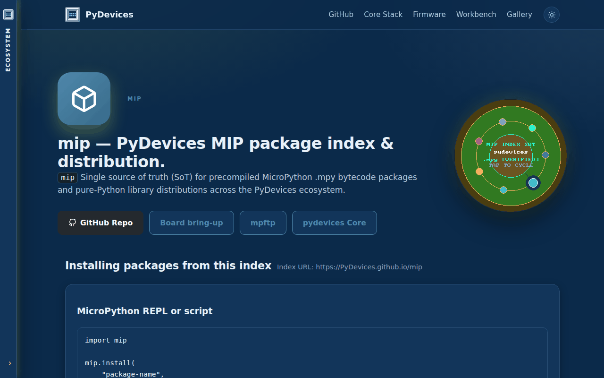

# PyDevices package index

A `mip` package index for MicroPython: every PyDevices library, plus all of micropython-lib, as precompiled `.mpy` files or plain `.py` source.

## Install

On a board with a network connection:

```python
import mip
mip.install("palettes", index="https://PyDevices.github.io/mip")
```

From your computer, onto a board on USB (the board needs no network):

```bash
mpremote mip install --index https://PyDevices.github.io/mip palettes
```

## Try it

With the unix port of MicroPython, install a package into `lib/` and use it:

```bash
micropython -m mip install --index https://PyDevices.github.io/mip --target lib palettes
```

```python
from palettes import get_palette

wheel = get_palette(name="wheel", length=360, color_depth=16)
print("red, green, blue as RGB565: 0x%04X 0x%04X 0x%04X" % (wheel[0], wheel[120], wheel[240]))
```

```text
red, green, blue as RGB565: 0xF800 0x07E0 0x001F
```

[Docs](https://github.com/PyDevices/mip/blob/PyDevices/docs/index.md) · [Examples](https://pydevices.github.io/gallery/gallery/) · [Roadmap](ROADMAP.md)

Made by [PyDevices](https://pydevices.com).
